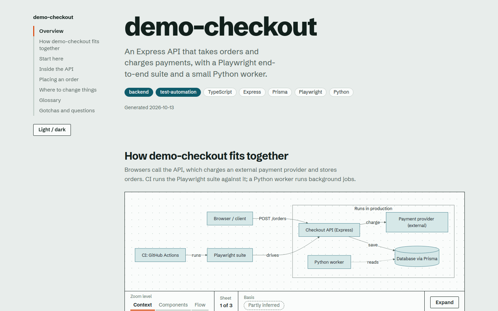

# Codebase Flow Mapper

**Understand an unfamiliar codebase in 15 minutes, with any AI model.**

An open-source toolkit that scans a repository and produces one self-contained HTML page: layered flow diagrams, a "start here" reading order, a component table, a glossary and a "where do I change X?" guide. The scripts are plain Python, the instructions are plain Markdown, and any model (hosted, local, in a chat window or inside an IDE) can supply the one step that needs judgement.

**[Live example](https://YOUR-USERNAME.github.io/codebase-flow-mapper/)**, generated from the small demo repo in [`examples/`](examples/demo-repo).

> Before publishing, replace the GitHub owner/repository placeholders and `YOUR NAME` in the MIT license.



## Why

A new teammate's first question is "how does all this fit together?", and the honest answers are usually a stale wiki page or "ask Sam". One diagram of the whole repo doesn't help either: it's too vague to teach anything or too dense to read. So the page zooms in three steps:

| Zoom level | Shows | Answers |
|---|---|---|
| Context | The repo and the systems around it | What is this and how does it run? |
| Components | The main parts and their dependencies | What are the pieces and who depends on whom? |
| Flow | One real sequence (a request, a test run, a deploy) | What actually happens, step by step? |

It handles frontend apps, backends, test-automation suites, infrastructure and CI repos, data pipelines, monorepos, libraries, CLIs and mobile apps; each type has its own guidance on which flows matter.

## How it's put together

The design goal is that **no part depends on a particular AI product**.

| Part | What it is | Needs an AI? |
|---|---|---|
| **The tool** (`codeflow/`) | Python scripts (standard library only): `scan` collects evidence and a dependency graph, `render` turns a JSON spec into the HTML page and **verifies every file path the page cites exists in your repo** | No |
| **The playbook** ([`PLAYBOOK.md`](PLAYBOOK.md)) | Plain-Markdown instructions any model can follow, with the spec [JSON Schema](codeflow/schema/spec.schema.json) | Read by one |
| **Adapters** (`codeflow.py install`) | Tiny generated files that point a given tool at the playbook (`AGENTS.md`, Cursor, Copilot, Gemini CLI, Claude) | Per tool |

The only judgement-heavy step is writing the spec (which diagrams, what each part does, where to start reading). A model does that; everything before and after is deterministic.

## One-command CLI

Install `pipx` first if needed, then install the CLI from GitHub (replace `OWNER/REPO` with its GitHub path):

```bash
pipx install "git+https://github.com/OWNER/REPO.git"
```

Configure an API key and model supported by an OpenAI-compatible Chat Completions API. In PowerShell:

```powershell
$env:CODEFLOW_API_KEY = "your-api-key"
$env:CODEFLOW_MODEL = "your-provider-model"
```

These PowerShell assignments last for the current terminal session. For a persistent setup, add both values as
user environment variables in Windows Settings, then open a new terminal. On macOS/Linux, export them in your
shell profile.

For other compatible providers, set `CODEFLOW_API_BASE_URL` to their API base URL (it should end in `/v1`).
Keep the API key in an environment variable; do not commit it to a repository.

From the repository you want to map, run:

```bash
codeflow map .
```

Confirm the upload when prompted. The command sends a context pack containing selected source excerpts to your
configured provider, saves the generated spec under `.codeflow/spec.json`, validates it against repository paths,
and writes `codebase-map.html`. Use `--out path/to/map.html` to change the HTML output path. Add `--yes` only
when you have reviewed the privacy implications and need to skip the interactive confirmation.

The context pack uses best-effort secret redaction, not a guarantee. Review your provider's data-handling terms
before sending private or regulated source code. API usage may incur charges from the provider.

## Quick start: pick the path that matches your AI

Get the code first:

```bash
git clone https://github.com/YOUR-USERNAME/codebase-flow-mapper.git
```

### 1. Chat only (ChatGPT, Gemini, Claude.ai, a local model, anything that takes text)

```bash
python3 codebase-flow-mapper/codeflow/codeflow.py pack /path/to/your/repo
# -> .codeflow/context-pack.md  (up to about 15k tokens)
```

Paste or upload that file to the model. It replies with a single JSON object. Save it as `spec.json`, then:

```bash
python3 codebase-flow-mapper/codeflow/codeflow.py render spec.json --repo /path/to/your/repo --out codebase-map.html
```

The renderer lists any file path the model cited that doesn't exist. Paste those warnings back to the model and ask it to resend the JSON. Open `codebase-map.html` in a browser.

### 2. A coding agent or IDE assistant that can run commands

```bash
cd /path/to/your/repo
python3 /path/to/codebase-flow-mapper/codeflow/codeflow.py install agents    # or: cursor | copilot | gemini | claude
```

Then ask: *"Map this repo for a new joiner."* The generated instructions tell the agent to read the playbook, run `scan`, read selectively, write the spec and run `render`.

| Target | File written |
|---|---|
| `agents` | `AGENTS.md` (a convention read by a growing list of coding agents) |
| `cursor` | `.cursor/rules/codebase-flow-mapper.mdc` |
| `copilot` | `.github/copilot-instructions.md` |
| `gemini` | `GEMINI.md` |
| `claude` | `.claude/skills/codebase-flow-mapper/` (add `--global` for all projects) |

Installs are idempotent and append to existing files between `codeflow:begin/end` markers, so your own notes stay intact.

### 3. Claude.ai

Run `python3 codeflow/codeflow.py build-skill` (or download `codebase-flow-mapper.skill` from the [latest release](../../releases/latest)) and upload it in Claude's skills settings.

## Commands

```
codeflow map    <repo> [--out FILE] [--model MODEL] [--api-base-url URL] [--yes]
codeflow scan   <repo> [--out DIR] [--depth N]                 evidence: scan.json + graph.json
codeflow pack   <repo> [--max-chars N] [--structure-only]      one file for any chat model
codeflow render <spec.json> --repo R [--strict] [--inline-mermaid mermaid.min.js]
codeflow install {agents,cursor,copilot,gemini,claude} [--dir D] [--global]
codeflow build-skill [--out DIR]                               package the Claude skill
```

Needs Python 3.9+. The original scan/pack/render commands use only the standard library. The `map` command calls
an external OpenAI-compatible API; an API key, model name, internet access and possible provider charges apply.

## What the page guarantees (and doesn't)

- **Every cited path is checked** against the repo, and Mermaid labels are linted for the mistakes that most often break rendering. An invented file path fails the build.
- **Uncertainty is shown, not hidden.** Anything the model reasoned from names rather than code is marked *inferred* (dashed outlines and dashed edges); unknowns go under *open questions*.
- **Dependency graph:** folder-level for JS/TS (including tsconfig aliases and workspace packages), Python, Go and Java/Kotlin. It zooms in automatically when one folder holds most of the code, and shows flat packages file by file. It is regex-based, so it can't see dependency injection, plugin registries or computed imports.
- **Offline:** fonts are bundled. Diagrams load [Mermaid](https://mermaid.js.org) from a pinned CDN version; for a fully offline file add `--inline-mermaid node_modules/mermaid/dist/mermaid.min.js` (from `npm i mermaid`; the file grows to about 2.7 MB).

## Privacy and safety

- `scan`, `pack` and `render` run locally and send nothing anywhere. `codeflow map` sends its generated context pack to the configured AI API after interactive confirmation (or with `--yes`).
- **A context pack contains excerpts of your source code** (README, manifests, entry points, CI files, a few key modules). Only send it to services you're allowed to share that code with. `pack --structure-only` omits all source excerpts.
- Common secret formats (keys, tokens, passwords, connection-string credentials, private keys) are redacted from excerpts, and `.env`, key and credential files are never included. This is a best-effort filter, not a guarantee: read the pack before you send it.
- The generated page describes your repository's structure and files. Treat it like the code: don't publish a page generated from a private repo.

## Status

Early (v0.2). What has been exercised so far:

- The `map` API flow is covered with a local mock server; `scan`, `pack`, `render` and every `install` target have smoke tests in [`tests/`](tests).
- CI installs the package and checks the `codeflow` command on Python 3.9 and 3.12.
- Scan and graph were run on the demo repo and on real open-source projects in several languages (Express, Requests, Cobra, Spring PetClinic, Playwright), which drove the auto-zoom graph and the repo-type detection.
- The chat-only flow was run end to end on Express: a model wrote the spec from a pack alone and `render --strict` verified all 26 cited paths ([`examples/express/`](examples/express)).

What has **not** been verified: how each third-party tool (Cursor, Copilot, Gemini CLI, other agents) actually behaves with the generated instruction files. They follow each tool's documented file format, but model behaviour varies and the formats evolve. Quality of the spec depends on the model; weaker models tend to produce thinner "flow" diagrams. Issues and examples are very welcome.

## Layout

```
codeflow/        the tool: codeflow.py (CLI), scan/graph/pack/render scripts, template, fonts, schema, per-repo-type guides
PLAYBOOK.md      the model-neutral instructions (single source of truth; adapters and the Claude skill are generated from it)
examples/        demo repo + spec, a real-world example (Express), run_demo.sh
tests/           smoke and regression tests
docs/            live demo page (GitHub Pages) and images
```

Try it without any AI: `./examples/run_demo.sh` runs scan, pack and render on the bundled demo with a pre-written spec.

## Contributing

Most useful: guides for stacks that aren't covered well (`codeflow/references/`), import resolution for more languages (`codeflow/import_graph.py`), adapters for other tools (`adapter_block()` and `cmd_install()` in `codeflow/codeflow.py`), and real-world pages (with permission) that show where the output falls short. Run `python3 -m unittest discover -s tests -v` before sending a change.

## License

[MIT](LICENSE). Bundled fonts (Schibsted Grotesk, JetBrains Mono) are under the SIL Open Font License; see [THIRD_PARTY_NOTICES.md](THIRD_PARTY_NOTICES.md).
